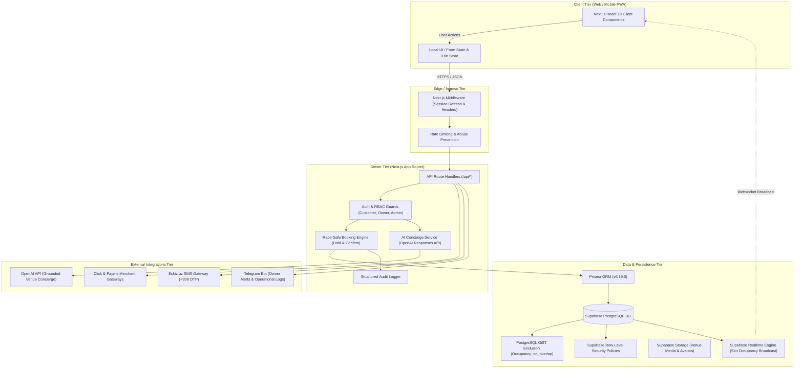

# SpaceHub UZ — Architecture & Technical Specifications

## 1. High-Level Architecture Overview

SpaceHub UZ is engineered with a modular, server-authoritative Next.js App Router architecture, backed by PostgreSQL on Supabase with strict Row-Level Security (RLS) and Prisma ORM for type-safe queries.



---

## 2. Security & RBAC Model

SpaceHub UZ defines 4 primary business roles:
1. **ANONYMOUS / GUEST:** Can browse verified venues, view general availability intervals (without booker PII), read published reviews, interact with AI concierge.
2. **CUSTOMER:** Authenticated via verified +998 phone number. Can create 15-minute booking holds, confirm bookings via payment, view own booking history, leave verified reviews, manage favorites, submit support tickets.
3. **VENUE_OWNER:** Associated with one or more `OwnerOrganization` entities. Manages venue profiles, resources, pricing rules, blackout blocks, and views authorized operational reservation records.
4. **ADMIN:** System administrator. Moderates venues, manages disputes and refunds, reviews audit logs, oversees platform metrics. Admin access is strictly enforced server-side; client metadata cannot escalate privileges.

---

## 3. Database Integrity & Race-Safe Double Booking Prevention

The core reliability guarantee is enforced at the PostgreSQL database engine level using PostgreSQL range types and GiST exclusion constraints:

```sql
CREATE EXTENSION IF NOT EXISTS btree_gist;

ALTER TABLE "Occupancy" 
ADD CONSTRAINT "Occupancy_no_overlap" 
EXCLUDE USING gist (
    "resourceId" WITH =,
    tstzrange("startsAt", "endsAt", '[)') WITH &&
) WHERE ("status" <> 'RELEASED');
```

### Invariant Rules:
1. Two active occupancies (`HELD`, `REQUESTED`, `CONFIRMED`, `BLOCKED`) cannot overlap on the same `resourceId` during `[startsAt, endsAt)`.
2. Temporary holds require an explicit `expiresAt` timestamp (default 15 minutes). An automated cleanup worker releases expired holds to `RELEASED` status.
3. Time slots are stored strictly in UTC `TIMESTAMPTZ` and displayed in the venue's timezone (`Asia/Tashkent` by default).

---

## 4. Payment & Webhook Architecture

- Supported domestic gateways: **Click.uz** and **Payme.uz**.
- Transaction lifecycle: `INITIATED` -> `PENDING` -> `COMPLETED` / `FAILED` / `REFUNDED`.
- Security contract:
  - All webhooks verify MD5/SHA256 signatures or HTTP Basic authentication.
  - Webhooks check whether transaction amounts match the booking `totalAmount` in UZS.
  - Transactions are strictly idempotent using `idempotencyKey` / `providerTransactionId`.
  - Client-side confirmation requests are never accepted as proof of payment.

---

## 5. Storage & Media Asset Policy

- Bucket names: `venue-media` (public read, owner upload) and `user-avatars` (authenticated customer upload).
- Upload constraints: Max file size 5MB, accepted mime types `image/jpeg`, `image/png`, `image/webp`.
- Provenance: All promotional graphics use original SVGs generated specifically for SpaceHub UZ. Real property listings only show genuine photos uploaded by verified owners.
