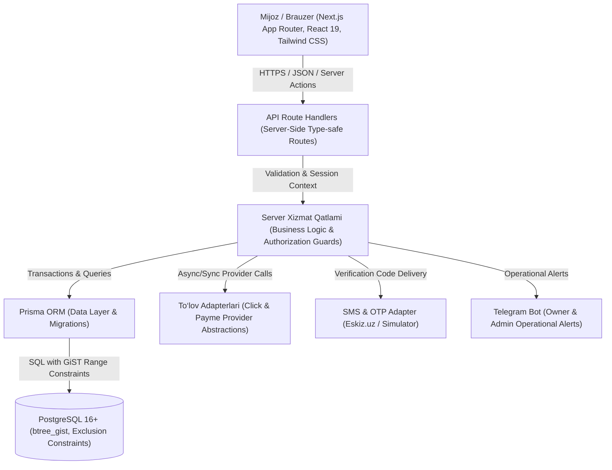
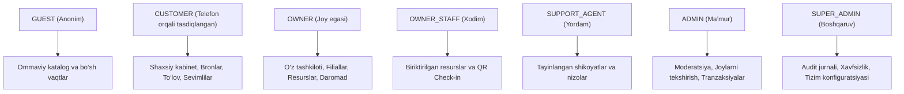
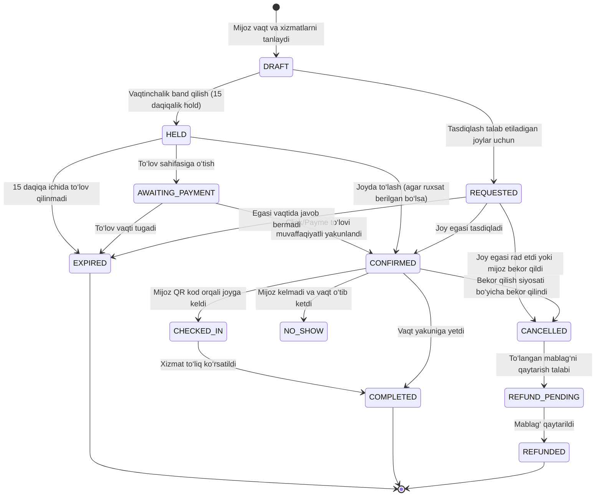

# SpaceHub UZ — Arxitektura va Tizim Loyihasi

SpaceHub UZ O‘zbekiston bo‘ylab kovorkinglar, sport maydonlari, konferensiya va majlis xonalari hamda tadbir joylarini kashf qilish va real vaqtda bron qilish bo‘yicha ko‘p toifali, gibrid bozor platformasi hisoblanadi.

Ushbu hujjat tizim arxitekturasi, foydalanuvchi rollari, ma’lumotlar bazasi loyihasi va bron qilish holat mashinasi (state machine) spetsifikatsiyasini to‘liq bayon etadi.

---

## 1. Tizim arxitekturasi va qatlamlari



---

## 2. Foydalanuvchi rollari va ruxsatlar (RBAC)

Platformada 7 ta aniq belgilangan rol mavjud. Ruxsatlar faqat frontendda emas, har bir server API so‘rovida va tranzaksiyada tekshiriladi:

| Rol               | Kirish doirasi va vakolatlari                                                                                                                                                                                                               |
| :---------------- | :------------------------------------------------------------------------------------------------------------------------------------------------------------------------------------------------------------------------------------------ |
| **GUEST**         | Anonim foydalanuvchi: ommaviy katalog, joylar, fotogalereyalar, qulayliklar va bo‘sh/band vaqtlarni (shaxsiy ma’lumotlarsiz) ko‘rish.                                                                                                       |
| **CUSTOMER**      | Tasdiqlangan mijoz (+998 telefon): o‘z profili, sevimli joylar, yangi bron qilish, to‘lov, o‘z buyurtmalari tarixi, QR chek-in, bekor qilish va sharh qoldirish.                                                                            |
| **OWNER**         | Tasdiqlangan joy egasi: o‘z tashkiloti (Organization), filiallar, resurslar, narx qoidalari, ish jadvali, texnik bloklar, buyurtmalarni tasdiqlash/rad etish, daromad va statistika. Boshqa egasining ma’lumotlariga qat’iyan kira olmaydi. |
| **OWNER_STAFF**   | Joy xodimi: faqat o‘ziga biriktirilgan resurslar bo‘yicha buyurtmalarni ko‘rish, mijozlarni QR orqali ro‘yxatdan o‘tkazish (check-in) va joriy holatni yangilash.                                                                           |
| **SUPPORT_AGENT** | Qo‘llab-quvvatlash xodimi: faqat o‘ziga biriktirilgan shikoyatlar (tickets), nizolar va bekor qilingan buyurtmalar tafsilotlarini tekshirish (ortiqcha shaxsiy ma’lumotlarsiz).                                                             |
| **ADMIN**         | Platforma ma’muri: yangi joylarni moderatsiya qilish, e’lonlarni tasdiqlash/to‘xtatish, umumiy buyurtmalar monitoringi, to‘lov va komissiyalarni ko‘rish, promo-kodlar.                                                                     |
| **SUPER_ADMIN**   | Tizim rahbari: xavfsizlik audit loglari, xodimlar va adminlar huquqlarini boshqarish, tizim sozlamalari va moliyaviy yarashuvlar.                                                                                                           |



---

## 3. Relyatsion ma’lumotlar bazasi tuzilishi (PostgreSQL + Prisma)

Baza to‘liq normallashtirilgan bo‘lib, quyidagi mantiqiy guruhlardan tashkil topgan:

### 3.1. Foydalanuvchilar va xavfsizlik

- **User**: id (UUID), phone (e.g. `+998901234567`), phoneVerified (Boolean), createdAt, updatedAt.
- **UserProfile**: userId, firstName, lastName, email, avatarUrl, preferredLanguage (`uz`, `ru`, `en`), themePreference (`light`, `dark`), notificationPreferences (JSON).
- **Session**: id, userId, tokenHash, ipAddress, userAgent, expiresAt, revokedAt.
- **RoleAssignment**: id, userId, role (`CUSTOMER`, `OWNER`, `OWNER_STAFF`, `SUPPORT_AGENT`, `ADMIN`, `SUPER_ADMIN`), organizationId (ixtiyoriy), resourceId (ixtiyoriy).

### 3.2. Tashkilotlar, joylar va resurslar

- **OwnerOrganization**: id, name, legalName, taxId (STIR), verified (Boolean), createdAt.
- **OwnerMembership**: id, organizationId, userId, role (`OWNER`, `STAFF`).
- **Venue**: id, organizationId, slug, name, description, address, city, district, latitude, longitude, timezone (`Asia/Tashkent`), publishedAt, verifiedAt, cancellationPolicy, houseRules.
- **Resource**: id, venueId, name, categoryId, capacity, basePriceHourly, active, slotDurationMinutes.
- **OpeningHours**: id, resourceId, dayOfWeek (0-6), openTime, closeTime.
- **ResourceBlock**: id, resourceId, startsAt, endsAt, reason.

### 3.3. Bandlik va bronlash (Race-safe Inventory)

- **Occupancy**:
  - `id` (UUID PK)
  - `resourceId` (UUID FK)
  - `startsAt` (TIMESTAMPTZ)
  - `endsAt` (TIMESTAMPTZ)
  - `status` (`HELD`, `REQUESTED`, `CONFIRMED`, `BLOCKED`, `RELEASED`)
  - `expiresAt` (TIMESTAMPTZ, nullable)
  - **GiST Exclusion Constraint**:
    ```sql
    CONSTRAINT "Occupancy_no_overlap" EXCLUDE USING gist (
      "resourceId" WITH =,
      tstzrange("startsAt", "endsAt", '[)') WITH &&
    ) WHERE ("status" <> 'RELEASED');
    ```
- **Booking**:
  - id, bookingNumber, customerId, resourceId, occupancyId, startsAt, endsAt, status, totalPrice, currency (`UZS`), cancellationDeadline, checkInCode (QR).
- **BookingStatusEvent**: id, bookingId, fromStatus, toStatus, reason, actorUserId, createdAt.
- **BookingCheckIn**: id, bookingId, checkedInAt, scannedByUserId, method (`QR_SCAN`, `MANUAL`).

### 3.4. To‘lovlar va moliya

- **Payment**: id, bookingId, provider (`CLICK`, `PAYME`, `CASH_ON_ARRIVAL`), providerTransactionId, amount (UZS butun sonlarda), status (`PENDING`, `PAID`, `FAILED`, `REFUNDED`), idempotencyKey.
- **Refund**: id, paymentId, amount, status (`PENDING`, `APPROVED`, `REJECTED`, `PROCESSED`), reason, processedAt.

### 3.5. Foydalanuvchi tajribasi va xizmatlar

- **Review**: id, venueId, customerId, bookingId, rating (1-5), comment, publishedAt.
- **Favorite**: id, userId, venueId, createdAt.
- **SupportTicket**: id, customerId, bookingId, subject, status (`OPEN`, `IN_PROGRESS`, `RESOLVED`, `CLOSED`), priority.
- **AuditLog**: id, actorUserId, action, entityName, entityId, payload (JSON), ipAddress, createdAt.

---

## 4. Bron qilish holat mashinasi (Booking State Machine)

Bronlash hayotiy sikli har bir holat o‘tishida to‘liq tekshiriladi:



### Holatlarning inventarni egallashi (Inventory Occupancy)

| Holat              | Inventarni band qiladimi? | Izoh                                                                   |
| :----------------- | :------------------------ | :--------------------------------------------------------------------- |
| `HELD`             | **HA**                    | Boshqa mijozlar bu vaqtni band qila olmaydi (Hold muddati: 15 min).    |
| `AWAITING_PAYMENT` | **HA**                    | To‘lov jarayonida vaqt saqlanadi.                                      |
| `REQUESTED`        | **HA**                    | Joy egasining tasdiqlashini kutish vaqtida band saqlanadi.             |
| `CONFIRMED`        | **HA**                    | To‘liq tasdiqlangan va to‘langan buyurtma.                             |
| `CHECKED_IN`       | **HA**                    | Mijoz ayni paytda joydan foydalanmoqda.                                |
| `BLOCKED`          | **HA**                    | Joy egasi tomonidan texnik xizmat/ta’mirlash uchun yopilgan vaqt.      |
| `DRAFT`            | YO‘Q                      | Savatchada yoki tanlanayotgan holat.                                   |
| `CANCELLED`        | YO‘Q                      | Bekor qilingan, vaqt boshqalar uchun ochiladi (`status = 'RELEASED'`). |
| `EXPIRED`          | YO‘Q                      | Muddati o‘tgan hold yoki tasdiqlanmagan so‘rov.                        |
| `COMPLETED`        | YO‘Q                      | Yakunlangan bron.                                                      |
| `REFUNDED`         | YO‘Q                      | To‘lov qaytarilgan, bandlik bo‘shatilgan.                              |

---

## 5. Loyiha papka tuzilishi (Folder Structure)

```text
spacehub-uz/
├── .github/
│   └── workflows/
│       └── ci.yml             # GitHub Actions CI (PostgreSQL 16, lint, typecheck, tests, build)
├── docs/
│   ├── architecture.md        # Tizim arxitekturasi, rollar, schema va holat mashinasi
│   └── phases.md              # 10 ta rivojlanish bosqichi holati va qadamlar
├── prisma/
│   ├── schema.prisma          # PostgreSQL relying modellari
│   ├── seed.mjs               # Ishlab chiqish uchun xavfsiz test ma’lumotlari
│   └── migrations/            # Versiyalangan PostgreSQL SQL migratsiyalari (GiST exclusion)
├── src/
│   ├── app/
│   │   ├── (customer)/        # Mijoz sahifalari: /, /explore, /venues/[slug], /booking, /checkout, /account
│   │   ├── (owner)/           # Joy egasi portali: /owner/dashboard, /owner/venues, /owner/calendar, etc.
│   │   ├── (admin)/           # Ma’mur paneli: /admin/dashboard, /admin/moderation, /admin/bookings, etc.
│   │   ├── api/               # Server-side API handlerlari
│   │   ├── globals.css        # Tailwind CSS va dizayn tokenlari (yorug‘/qorong‘i mavzular)
│   │   └── layout.tsx         # Asosiy layout
│   ├── booking/
│   │   └── state-machine.ts   # Bronlash holat mashinasi va inventar qoidalari
│   ├── catalog/
│   │   └── categories.ts      # 22 ta asosiy xizmat va joy toifalari
│   ├── server/
│   │   ├── db.ts              # PrismaClient yagona instansiyasi
│   │   ├── availability-window.ts # Vaqt oraliqlarini validatsiya qilish
│   │   └── public-venues.ts   # Ommaviy e’lonlarni qidirish va olish
│   └── lib/                   # Xavfsizlik, sessiya, i18n, formatlash yordamchilari
├── tests/
│   ├── availability-window.test.mjs
│   ├── categories.test.mjs
│   ├── health.test.mjs
│   ├── state-machine.test.mjs
│   └── occupancy-postgres.test.mjs
├── .env.example               # Barcha konfiguratsiya kalitlari uchun shablon
├── package.json
└── tsconfig.json
```
